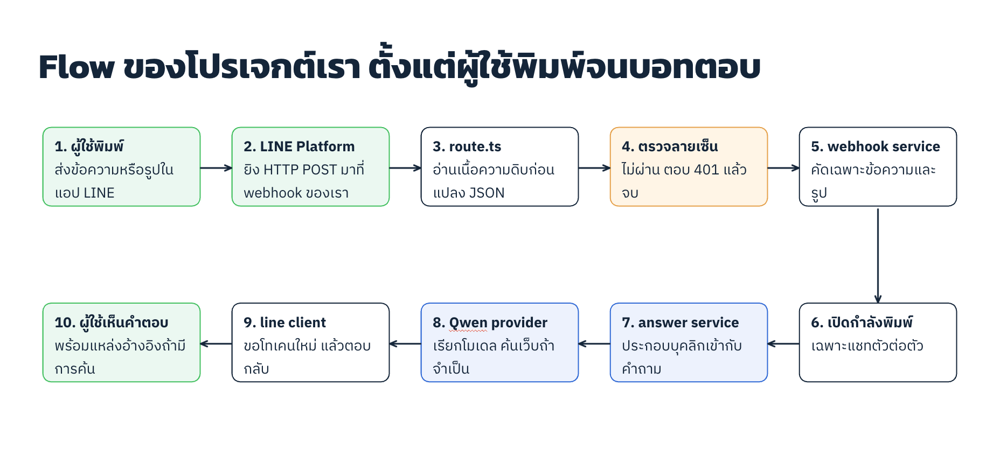

# LINE + Qwen Secretary Bot

Starter project สำหรับเรียนรู้และต่อยอด: แชทบอท LINE Official Account ชื่อ "น้องมีนา" ที่ตอบคำถามด้วย Qwen รองรับทั้งข้อความและรูปภาพ และค้นเว็บได้เมื่อคำถามต้องใช้ข้อมูลปัจจุบัน

**Stack:** Next.js 16 (App Router) · TypeScript · Vitest · ไม่มีฐานข้อมูล

## Flow การทำงาน



| ขั้น | ไฟล์ | หน้าที่ |
|---|---|---|
| 3–4 | [`src/app/api/webhooks/line/route.ts`](src/app/api/webhooks/line/route.ts) | อ่าน body ดิบ แล้วตรวจลายเซ็น HMAC ถ้าไม่ผ่านตอบ 401 |
| 5–6 | [`src/services/line-webhook.service.ts`](src/services/line-webhook.service.ts) | คัดเฉพาะข้อความและรูป แสดงสถานะกำลังพิมพ์ ดาวน์โหลดรูป แล้วส่งคำตอบกลับ |
| 7 | [`src/services/answer.service.ts`](src/services/answer.service.ts) | ต่อ persona กับ `BOT_INSTRUCTIONS` เป็น system prompt |
| 8 | [`src/lib/ai/qwen-answer-provider.ts`](src/lib/ai/qwen-answer-provider.ts) | เรียก Qwen Responses API พร้อม web search และกรองลิงก์อ้างอิง |
| 9 | [`src/lib/line/client.ts`](src/lib/line/client.ts) | ขอ token ใหม่ทุกครั้งที่เรียก LINE API (ตอบกลับ, กำลังพิมพ์, ดาวน์โหลดรูป) |

แอปเป็นแบบ **stateless**: ไม่เก็บประวัติแชท userId หรือรูปภาพ ทุกข้อความถูกตอบแยกกัน บอทจึงจำบทสนทนาก่อนหน้าไม่ได้ ทุกบรรทัดในโค้ดมีคอมเมนต์ภาษาไทยอธิบายไว้

## เริ่มต้นใช้งาน

**ติดตั้งและตั้งค่า**

```bash
npm install
cp .env.example .env.local   # แล้วใส่ค่าจริงใน .env.local
npm run dev                  # http://localhost:3000
```

| ตัวแปร | จำเป็น | คำอธิบาย |
|---|---|---|
| `LINE_CHANNEL_ID`, `LINE_CHANNEL_SECRET` | ✅ | จาก LINE Developers Console → Messaging API channel |
| `QWEN_API_KEY` | ✅ | จาก Alibaba Cloud Model Studio (DashScope) |
| `QWEN_MODEL` | | ค่าเริ่มต้น `qwen3.8-flash` |
| `QWEN_BASE_URL` | | ค่าเริ่มต้นเป็น endpoint สิงคโปร์ ต้องเป็นภูมิภาคเดียวกับ API key |
| `QWEN_ENABLE_WEB_SEARCH` | | ตั้งเป็น `false` เพื่อปิดการค้นเว็บ ช่วยให้ตอบเร็วขึ้นและประหยัดค่าใช้จ่าย |
| `BOT_INSTRUCTIONS` | | ข้อมูลขององค์กร เช่น เวลาทำการ หรือเบอร์ติดต่อ (ดูหัวข้อปรับแต่งบอท) |

## ปรับแต่งบอท

- **บุคลิกและกฎ:** แก้ไฟล์ [`src/config/bot-persona.ts`](src/config/bot-persona.ts) ต้อง deploy ใหม่หลังแก้
- **ข้อมูลองค์กร:** ใส่ใน `BOT_INSTRUCTIONS` แต่ละองค์กรที่ fork ไปใช้ค่าต่างกันได้โดยไม่ต้องแก้โค้ด **ห้ามใส่ข้อมูลลับ** เพราะผู้ใช้อาจหลอกให้บอทเปิดเผยเนื้อหาใน prompt ได้
- **เปลี่ยนไปใช้ AI เจ้าอื่น:** สร้างคลาสใหม่ที่ implements `AnswerProvider` ([`answer-provider.ts`](src/lib/ai/answer-provider.ts)) วางไว้ข้าง `QwenAnswerProvider` แล้วเปลี่ยนจุดที่สร้าง provider ใน webhook service
- **เพิ่มความจำแชท:** เพิ่มฐานข้อมูล แล้วส่งประวัติการคุยสั้น ๆ เข้า `AnswerService`

## ตรวจสอบโค้ด

```bash
npm run test        # unit test (ใช้ fetch ปลอม ไม่เรียก API จริง)
npm run typecheck
npm run build
```

## ข้อควรระวัง

- **ห้าม commit `.env` หรือ `.env.local`** และห้ามตั้งชื่อตัวแปรขึ้นต้นด้วย `NEXT_PUBLIC_` เพราะค่าจะหลุดไปถึงเบราว์เซอร์ ถ้า Channel secret หลุด ให้ออกค่าใหม่ทันที
- **ยังไม่พร้อมใช้งานจริง** ก่อนเปิดให้คนทั่วไปใช้ ควรเพิ่มสิ่งเหล่านี้:
  - rate limit ต่อผู้ใช้
  - จำกัดขนาด request body
  - ตอบ 200 ให้ LINE ทันที แล้วส่งงานต่อเข้า queue
  - เก็บ `webhookEventId` ไว้กันการประมวลผล event ซ้ำ
- รูปที่ผู้ใช้ส่งมาจะถูกส่งต่อไปให้ Qwen วิเคราะห์ ควรแจ้งผู้ใช้ไม่ให้ส่งเอกสารส่วนตัว

## เอกสารอ้างอิง

- LINE: [ตรวจลายเซ็น webhook](https://developers.line.biz/en/docs/messaging-api/verify-webhook-signature/) · [รับ event](https://developers.line.biz/en/docs/messaging-api/receiving-messages/) · [ตอบข้อความ](https://developers.line.biz/en/docs/messaging-api/sending-messages/) · [stateless token](https://developers.line.biz/en/reference/messaging-api/#issue-stateless-channel-access-token)
- Qwen: [Responses API](https://help.aliyun.com/en/model-studio/qwen-api-via-openai-responses) · [Web search](https://help.aliyun.com/en/model-studio/web-search)
